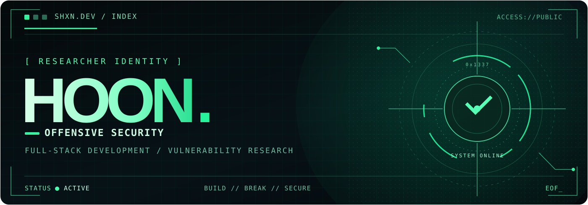

<div align="center">

  

  <br />

  <a href="https://shxn.dev">
    
  </a>
  <a href="https://github.com/apflffhtm">
    
  </a>
  <a href="https://hackerone.com/elbacode">
    
  </a>

  <br /><br />

  

</div>

---

### `01` / WHO AM I

```console
$ ./profile --verbose

[+] Handle      : hoon / apflffhtm
[+] Focus       : Web Security · Vulnerability Research · Full-Stack
[+] Research    : Web Exploitation · CTF · Open-Source Security
[+] Philosophy  : Build systems. Break assumptions. Share fixes.
[+] Status      : ONLINE  ■■■■■■■■■■ 100%
```

I build web applications and research the weaknesses hiding beneath their interfaces.
My interests lie at the intersection of **offensive security, open-source vulnerability research, and software engineering**.

### `02` / RESEARCH LOG

> Selected public vulnerability identifiers. See the respective disclosure records for full technical details.

| ID | Target | Research area |
| :--- | :--- | :--- |
| **CVE-2026-25450** | WordPress User Registration | Access Control |
| **CVE-2026-52708** | WordPress WP User Frontend | Access Control |
| **CVE-2026-121575** | WordPress WP User Manager | Access Control |

### `03` / ARSENAL

<div align="center">

**LANGUAGES & FRAMEWORKS**


**PLATFORM & INFRASTRUCTURE**


**SECURITY TOOLBOX**


</div>

### `04` / TELEMETRY

<div align="center">

  
  

  <br />

  

</div>

### `05` / TRANSMISSION

```text
$ printf "Code. Research. Secure.\n"
Code. Research. Secure.
```

<div align="center">
  <a href="https://shxn.dev"><strong>WEBSITE</strong></a>
  &nbsp; · &nbsp;
  <a href="https://github.com/apflffhtm"><strong>GITHUB</strong></a>
  &nbsp; · &nbsp;
  <a href="https://hackerone.com/elbacode"><strong>HACKERONE</strong></a>
  <br /><br />
  <sub>SHXN.DEV // END OF TRANSMISSION</sub>
</div>
